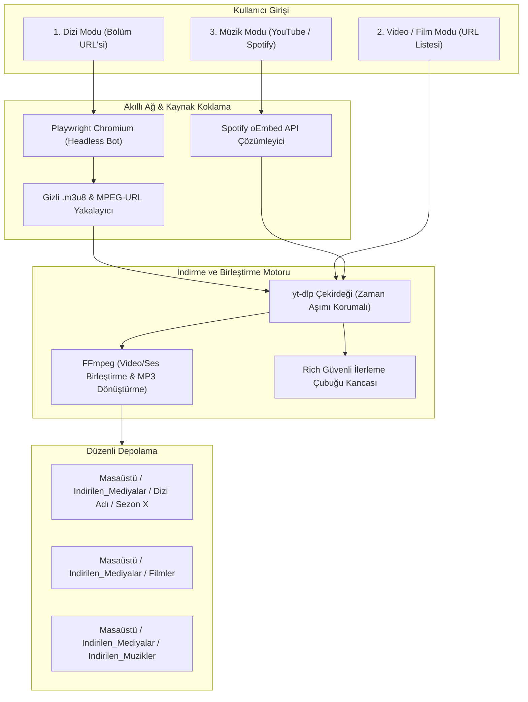

# 🛰️ Göktürk Medya İndirme Merkezi (v5.0)

[](https://github.com/mertahmet41/GokturkMediaDowlander/releases)
[](https://www.python.org/)
[](#)
[](#)
[](#)

**Göktürk Medya İndirme Merkezi**; dizi, film, sosyal medya videoları (YouTube, Instagram, TikTok, Twitter/X) ve müzikleri yüksek hızda, otomatik ve toplu olarak indirmek için geliştirilmiş gelişmiş bir **Siber İndirme İstasyonudur**.

Gelişmiş web kazıma (web scraping) ve ağ trafiği koklama (network sniffing) yetenekleri sayesinde gizli kaynak `.m3u8` medya akışlarını arka planda otomatik olarak yakalar, çözer ve yüksek kalitede bilgisayarınıza indirir.

---

## 🏗️ Çalışma Mantığı ve Mimari



---

## 🔥 v5.0 ile Gelen Yenilikler ve Çözülen Sorunlar

Önceki sürümdeki (`v4.5`) kritik hatalar tespit edilerek tamamen giderildi:

1. **İlerleme Çubuğu Çökmesi Giderildi (`KeyError: 'info_dict'`):**
   - HLS/m3u8 parçaları indirilirken `info_dict` anahtarı bulunmadığında uygulamanın donmasına/kapanmasına yol açan hata giderildi.
2. **Windows Dosya Adı Karakter Hatası (`[Errno 22]`) Çözüldü:**
   - Linklerde veya başlıklarda yer alan `?`, `:`, `*`, `"`, `<`, `>`, `|` karakterleri filtrelenerek indirme işlemi güvene alındı.
3. **M3U8 Playlist Filtresi Düzeltildi:**
   - Önceden `"playlist"` kelimesi içeren tüm akışlar filtrelendiği için birçok sitede video linki yakalanamıyordu. Bu engel kaldırıldı ve gerçek video akışları garantiye alındı.
4. **Spotify İndirme Altyapısı Yenilendi:**
   - Spotify linkleri resmi Spotify oEmbed API ile taranarak parça adı ve sanatçı bilgisiyle eşleştirildi, yüksek kaliteli MP3 indirmesi sağlandı.
5. **Windows Türkçe Terminal Encoding Hatası (`UnicodeEncodeError`) Düzeltildi:**
   - `✓`, `⚡`, `🚀` gibi karakterlerin Windows Türkçe terminallerinde (CP1254) sebep olduğu çökme `sys.stdout.reconfigure(encoding='utf-8')` ile çözüldü.
6. **Dizi İsmi Ayrıştırma Optimizasyonu:**
   - Örnek bölüm linklerinden dizi adı süzülürken sezon ve bölüm numaralarının dizi ismine yapışması düzeltildi.

---

## 📦 Sürüm Geçmişi ve Eski Sürüm (v4.5)

Kullanıcılarımızın önceki kod yapısını inceleyebilmesi için eski sürüm de depoda saklanmaktadır:

| Sürüm | Durum | Açıklama | Kaynak Kodu |
| :--- | :--- | :--- | :--- |
| **[v5.0 (Latest)](https://github.com/mertahmet41/GokturkMediaDowlander/releases/tag/v5.0)** | **Güncel & Kararlı** | Tüm hatalar giderildi, Spotify ve m3u8 iyileştirildi, birim testler eklendi | [Ana Dizin](.) |
| **[v4.5 (Legacy)](https://github.com/mertahmet41/GokturkMediaDowlander/releases/tag/v4.5)** | Arşiv (Eski Sürüm) | İlk prototip sürüm (orijinal haliyle korundu) | [archive/v4.5-legacy](archive/v4.5-legacy) |

> Ayrıntılı sürüm notları için **[docs/CHANGELOG.md](docs/CHANGELOG.md)** dosyasını inceleyebilirsiniz.

---

## 📂 Depo Dizin Yapısı

```text
GokturkMediaDownloader/
├── .gitignore                # Geçici ve medya dosyaları filtresi
├── README.md                 # Proje tanıtım ve kılavuz dokümanı
├── requirements.txt          # Gerekli Python kütüphaneleri
├── otuken.py                 # Hataları giderilmiş ve optimize edilmiş ana motor
├── main.py                   # Standart Python giriş noktası
├── calistir.bat              # Windows terminal başlatıcısı
├── kurulum.bat               # Windows otomatik kurulum sihirbazı
├── kaldir.bat                # Windows temiz kaldırma aracı (Uninstaller)
├── archive/                  # Eski sürümlerin korunduğu arşiv
│   └── v4.5-legacy/          # v4.5 sürümünün orijinal dosyaları
├── docs/                     # Ayrıntılı dokümantasyon
│   ├── CHANGELOG.md          # Sürüm ve hata düzeltme günlüğü
│   └── KULLANIM.md           # Adım adım detaylı kullanım kılavuzu
└── tests/                    # Otomatik birim testleri
    └── test_core.py          # Çekirdek fonksiyon testleri
```

---

## 🛠️ Kurulum ve Çalıştırma

### Otomatik Kurulum (Windows):
1. `kurulum.bat` dosyasına sağ tıklayıp **Yönetici Olarak Çalıştır**'ı seçin.
2. Sihirbaz Python kütüphanelerini, Playwright Chromium motorunu ve FFmpeg'i kurup masaüstünüze kısayol oluşturacaktır.

### Manuel Kurulum:
```bash
# 1. Bağımlılıkları yükleyin
pip install -r requirements.txt

# 2. Playwright Chromium motorunu kurun
playwright install chromium

# 3. Programı başlatın
python main.py
# veya
python otuken.py
```

### Testleri Çalıştırma:
```bash
python tests/test_core.py
```

---

## ⚖️ Yasal Uyarı
Bu araç açık kaynak kodlu ve eğitim amaçlı geliştirilmiştir. İndirilen içeriklerin telif hakları eser sahiplerine aittir.

---

## 👨‍💻 Geliştirici
- **Geliştirici:** Ahmet Mert ÇELİK (Wumpus)
- **GitHub:** [@mertahmet41](https://github.com/mertahmet41)
