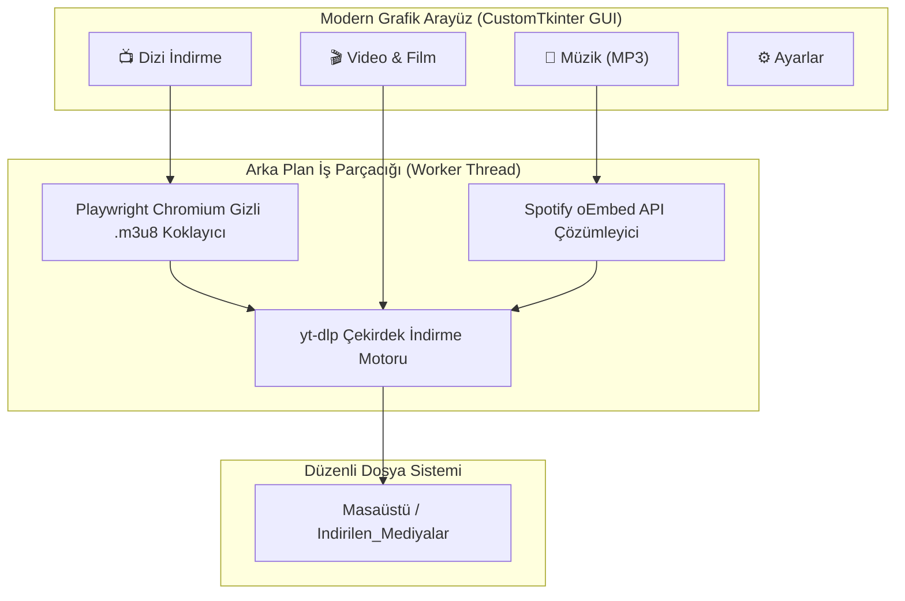

# 🛰️ Göktürk Medya İndirme Merkezi (v6.0.1)

[](https://github.com/mertahmet41/GokturkMediaDowlander/releases)
[](#)
[](https://github.com/mertahmet41/GokturkMediaDowlander/releases/latest)
[](#)

**Göktürk Medya İndirme Merkezi**; dizi, film, sosyal medya videoları (YouTube, Instagram, TikTok, Twitter/X) ve müzikleri yüksek hızda, otomatik ve toplu olarak indirmek için geliştirilmiş **Modern Grafik Arayüze (GUI)** sahip bağımsız bir **Siber İndirme İstasyonudur**.

---

## ⚡ Hızlı Başlangıç (Kurulumsuz Taşınabilir .EXE)

Herhangi bir Python veya ek kütüphane kurulumu yapmadan tek tıkla kullanmak için:

👉 **[GokturkMediaDownloader.exe İndir (v6.0.1)](https://github.com/mertahmet41/GokturkMediaDowlander/releases/latest)**

*İndirin, çift tıklayın ve doğrudan kullanmaya başlayın!*

---

## 🖥️ Modern Grafik Arayüz (GUI) Özellikleri

- 🎨 **Modern Koyu Tema (Dark Mode):** Siber mavi ve gri tonlarında göz yormayan çağdaş masaüstü deneyimi.
- 📺 **Gelişmiş Akıllı Dizi İndirici (v6.0.1):** 
  - URL alanında domaindeki rakamlar (örn. `dizipal942.com`, `hdfilmcehennemi15.net`) korunur, URL bozulmaz.
  - Tek bölümlü dizilerde sezon otomatik 1 kabul edilir. `S04E02` ve `1-sezon-2-bolum` gibi sıfır dolgulu formatlar tam desteklenir.
  - Arayüzde **"Dizi Adı"** alanı artık düzenlenebilir; ayrıca tek tıkla **"🔍 Çözümle"** butonu eklenmiştir.
- 🎬 **Toplu Video & Film İndirici (YouTube 403 Düzeltmesi):** 
  - YouTube SABR istemci uyuşmazlığı ve HTTP 403 Forbidden hatası giderildi.
  - En İyi Kalite, 1080p, 720p, 480p çözünürlük seçimi entegre edildi.
- 🎵 **Müzik (MP3) Çözümleyici:** YouTube ve Spotify şarkı linklerini otomatik yüksek kaliteli 192kbps/320kbps MP3 ses dosyasına dönüştürür.
- 📊 **Canlı İlerleme Çubuğu ve Hız Göstergesi:** İndirme yüzdesi, anlık transfer hızı (MB/s) ve kalan süre canlı görüntülenir.
- ⏹️ **Tek Tıkla İptal:** İstenildiğinde çalışan indirmeyi güvenle durdurma butonu.
- 📂 **Entegre Klasör Yöneticisi:** Medyaların kaydedileceği dizini seçme ve indirilenler klasörünü tek tıkla Windows Gezgini'nde açma.

---

## 🏗️ Çalışma Mantığı ve Mimari



---

## 📦 Sürüm Geçmişi

| Sürüm | Tür | Öne Çıkan Özellikler | Durum |
| :--- | :--- | :--- | :--- |
| **[v6.0.1](https://github.com/mertahmet41/GokturkMediaDowlander/releases/tag/v6.0.1)** | **Hotfix & Stabilite** | YouTube HTTP 403 Forbidden hatası çözüldü, Akıllı Dizi ayrıştırıcı geliştirildi, düzenlenebilir Dizi Adı ve Çözümle butonu eklendi | **Güncel (Latest)** |
| **[v6.0](https://github.com/mertahmet41/GokturkMediaDowlander/releases/tag/v6.0)** | GUI & Portable .EXE | Modern CustomTkinter masaüstü arayüzü, bağımsız tek dosya `.exe`, arka plan thread desteği | Arşiv |
| **[v5.0](https://github.com/mertahmet41/GokturkMediaDowlander/releases/tag/v5.0)** | CLI & Core Fixes | KeyError, Windows dosya adı, m3u8 playlist filtresi ve Spotify düzeltmeleri | Arşiv |
| **[v4.5](https://github.com/mertahmet41/GokturkMediaDowlander/releases/tag/v4.5)** | CLI (Legacy) | İlk kamuya açık prototip sürüm ([archive/v4.5-legacy](archive/v4.5-legacy)) | Arşiv |

---

## 🛠️ Kaynak Koddan Çalıştırma (Geliştiriciler İçin)

```bash
# 1. Depoyu klonlayın
git clone https://github.com/mertahmet41/GokturkMediaDowlander.git
cd GokturkMediaDowlander

# 2. Bağımlılıkları yükleyin
pip install -r requirements.txt

# 3. Playwright tarayıcı motorunu kurun
playwright install chromium

# 4. Grafik arayüzü başlatın
python main.py
# veya Komut Satırı modu için:
python main.py --cli
```

---

## ⚖️ Yasal Uyarı
Bu araç açık kaynak kodlu ve eğitim amaçlı geliştirilmiştir. İndirilen içeriklerin telif hakları eser sahiplerine aittir.

---

## 👨‍💻 Geliştirici
- **Geliştirici:** Ahmet Mert ÇELİK (Wumpus)
- **GitHub:** [@mertahmet41](https://github.com/mertahmet41)
